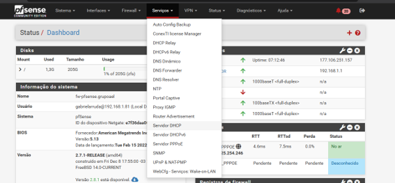
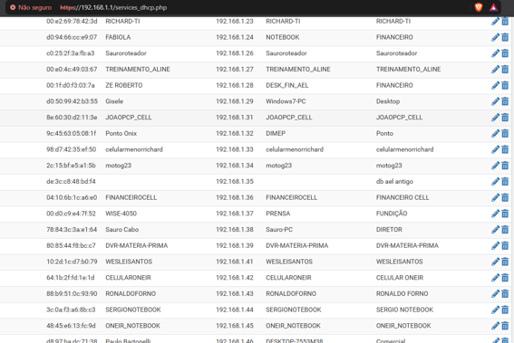
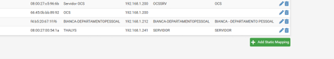
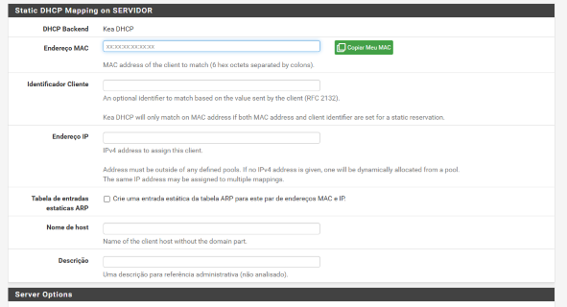
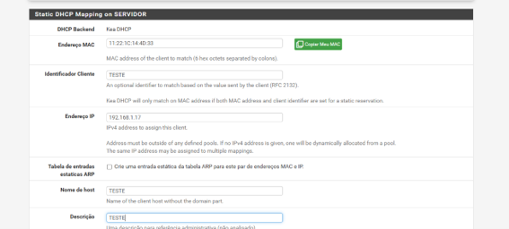
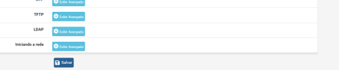

# Como Adicionar uma Nova Máquina à Rede de Internet

Este procedimento descreve como cadastrar uma máquina nova no servidor
DHCP para que ela utilize um endereço IP reservado na rede.

## Pré-requisitos

-   Ter acesso à interface de administração do equipamento de rede.
-   Ter o usuário e a senha necessários para entrar.
-   Saber o endereço MAC da placa de rede da máquina nova.
-   Confirmar que a máquina está configurada para obter o endereço IP
    automaticamente por DHCP.

> **Atenção:** escolha um endereço IP que esteja disponível na lista do
> servidor DHCP. Antes de salvar, confira com cuidado o endereço MAC e o
> IP informados.

## Passo 1 --- Acessar o painel de administração

1.  Abra o navegador da máquina que será utilizada para configurar a
    rede.
2.  Na barra de endereços, acesse: <https://192.168.1.1/>
3.  Pressione **Enter**.
4.  Quando a tela de autenticação aparecer, entre com seu usuário e sua
    senha.

**Imagem 1 --- Tela de acesso ao painel**

## Passo 2 --- Abrir as configurações do servidor DHCP

1.  No painel de administração, localize a aba **Serviços**.
2.  Dentro dessa aba, acesse **Servidor DHCP**.
3.  Aguarde a página carregar e localize a listagem de endereços IP.

**Imagem 2 --- Menu Serviços e opção Servidor DHCP**

## Passo 3 --- Encontrar um endereço IP disponível

1.  Role a página para baixo para visualizar a listagem de endereços IP.
2.  Examine os endereços apresentados e identifique um IP disponível
    para a máquina nova.
3.  Anote o endereço IP escolhido para utilizá-lo na próxima etapa.
4.  Confira cuidadosamente o endereço antes de continuar, para evitar
    cadastrar um IP que já esteja sendo utilizado.

**Imagem 3 --- Listagem de endereços IP**

## Passo 4 --- Adicionar um mapeamento estático

1.  Depois de escolher o endereço IP disponível, clique em **+ ADD
    STATIC MAPPING**.
2.  Aguarde a abertura da próxima tela, onde serão preenchidos os dados
    da máquina.

**Imagem 4 --- Botão Add Static Mapping**

## Passo 5 --- Preencher os dados da máquina

Na tela de cadastro:

1.  Informe o **endereço MAC** da máquina nova no campo correspondente.
2.  Informe o **endereço IP disponível** que você selecionou na listagem
    do servidor DHCP.
3.  Revise os dados preenchidos e confirme que o MAC e o IP estão
    corretos.

O endereço MAC identifica a interface de rede da máquina. Digite-o
exatamente como foi informado, sem trocar caracteres.

**Imagem 5 --- Formulário de cadastro do MAC e do IP**

## Passo 6 --- Salvar a configuração

1.  Depois de preencher os campos, role até o final da página.
2.  Clique em **Salvar**.
3.  Em seguida, localize o botão **Salvar** no topo da página e confirme
    a gravação, conforme indicado pela interface.
4.  Verifique se a configuração foi salva sem apresentar erro.

**Imagem 6 --- Salvar a configuração**

## Passo 7 --- Renovar a conexão da máquina

1.  Após salvar a configuração, desconecte o cabo de rede da máquina
    nova.
2.  Conecte o cabo novamente.
3.  Confirme que a configuração de rede da máquina está definida para
    obter o endereço IP automaticamente por **DHCP**.
4.  A máquina não deve estar configurada com um endereço IP manual
    (estático) nas configurações locais de rede.
5.  Verifique se a máquina recebeu o endereço IP cadastrado.

**Imagem 7 --- Configuração de rede da máquina**

## Checklist final

Antes de encerrar, confirme os itens abaixo:

-   [ ] Acessei o painel em `https://192.168.1.1/`.
-   [ ] Abri **Serviços \> Servidor DHCP**.
-   [ ] Escolhi um endereço IP disponível na listagem.
-   [ ] Cadastrei o endereço MAC correto da máquina nova.
-   [ ] Informei o endereço IP escolhido.
-   [ ] Salvei a configuração no formulário e confirmei o salvamento no
    topo da página.
-   [ ] Reconectei o cabo de rede.
-   [ ] Confirmei que a máquina está configurada para obter IP
    automaticamente por DHCP.
-   [ ] Verifiquei se a máquina recebeu o endereço IP cadastrado.

## Se a máquina não receber o IP esperado

-   Confira se o endereço MAC foi digitado corretamente.
-   Verifique se o IP cadastrado corresponde ao endereço escolhido na
    listagem.
-   Confirme que a configuração de rede da máquina está em DHCP
    automático, e não em IP manual.
-   Desconecte e reconecte o cabo de rede e aguarde alguns instantes.
-   Se o problema continuar, peça apoio ao responsável pela
    administração da rede antes de alterar outras configurações.

------------------------------------------------------------------------

**Observação:** os nomes dos menus e botões deste guia seguem o
procedimento fornecido. A aparência da interface pode variar conforme a
versão do equipamento ou do sistema de administração.
